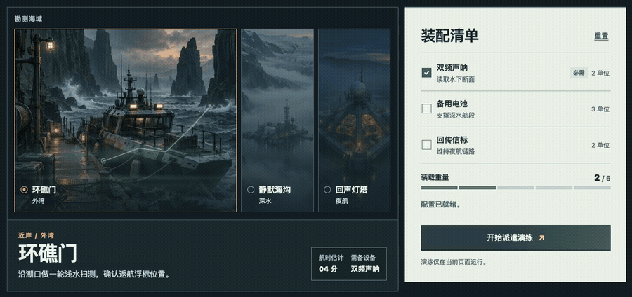

# Tian

Tian 是面向 Codex 的前端设计与实现技能，适合原创品牌官网、游戏发布页、世界观专题及互动工具。它把桌面宽窄媒体面板、章节导航、手机重排与可操作的控件结合起来，并按任务需要提供三档交互深度。



## 体验三档示例

克隆仓库或下载 ZIP 后，在浏览器打开 [三档总览](assets/gallery/index.html)。所有示例共享原创世界观《折光航线》，可以从本地文件离线运行。按场景规模和状态影响范围选择档位，同一个站点也可以按区域组合。

| 深度 | 示例 | 可以体验什么 |
| --- | --- | --- |
| **一档 · 基础反馈** | [折光航线发布站](assets/showcase/index.html) | 切换场景面板、浏览章节、播放影像、筛选日志，体验按钮的按压、等待与结果反馈。 |
| **二档 · 组件联动** | [回波校准](assets/depth-2/index.html) | 选中频段时卡片扩宽，遮罩与量程读数各自过渡。频段和灵敏度共同改变极坐标回波图。扫描可取消，也可保留参数后重跑。 |
| **三档 · 任务流程** | [航线调度台](assets/depth-3/index.html) | 航线卡扩展后，镜头推进，水光、海雾或暖色灯束随海域入场，航迹随后显现。右侧只为本次新增的设备要求亮起一次。根据装载条件启动本地派遣演练，支持取消、复位和查看回执。 |

桌面端通过宽窄变化强调当前场景。窄屏将选择器重排为紧凑标签，联动单一主画面。示例覆盖键盘、触屏、焦点反馈和减弱动效。扫描与派遣使用模拟数据。浏览器允许本地存储时，通行证可在本地保存。

## 安装到 Codex

通过仓库的 **Code** 按钮克隆，或下载 ZIP 后解压。在包含 `SKILL.md` 的仓库根目录运行以下命令，将技能复制到 Codex 的用户技能目录。

```bash
tian_skill_dir="${CODEX_HOME:-$HOME/.codex}/skills/tian"
mkdir -p "$tian_skill_dir"
cp -R SKILL.md agents assets references "$tian_skill_dir/"
```

安装后，在 Codex 的对话中输入 `$tian` 并描述任务。

> 用 $tian 为原创海洋探索游戏制作发布页。首屏和章节导航用一档，参数预览用二档，设备装配和派遣演练用三档。交付前验证桌面、手机和键盘操作。

## 仓库导览

| 路径 | 内容 |
| --- | --- |
| [`SKILL.md`](SKILL.md) | 技能入口，包含选择场景、控件深度与浏览器验收的工作流程。 |
| [`agents/openai.yaml`](agents/openai.yaml) | Codex 中的展示名称、描述和默认提示词。 |
| [`references/`](references/) | 页面实现、按钮状态、控件深度和参考站点的源码定位。 |
| [`assets/`](assets/) | 可在浏览器直接打开的示例、预览图与原创媒体。 |
| [`CHANGELOG.md`](CHANGELOG.md) | 更新记录。 |

## 参考来源

- **库洛游戏官网**提供场景编排、宽窄面板、遮罩和控件独立过渡的参考。[官网](https://www.kurogames.com/)
- **《鸣潮》官网**提供章节直达、媒体层次和桌面与手机布局的参考。[官网](https://mc.kurogames.com/main#main)
- **OJO Design Skills** 提供按钮层级、焦点、按压和状态反馈的参考。MIT 许可对应 OJO 上游仓库。[组件与动效说明](https://github.com/touchine-ojo/OJO-Design-Skills) · [上游许可](https://github.com/touchine-ojo/OJO-Design-Skills/blob/3ef911afdc605395a9d74b39eacd0298b70960f9/LICENSE)

Tian 的示例采用独立实现的 HTML、CSS 和 JavaScript，配套媒体基于原创题材生成。引用的定位线索和实现判断记录在[源码证据](references/source-study.md)。
